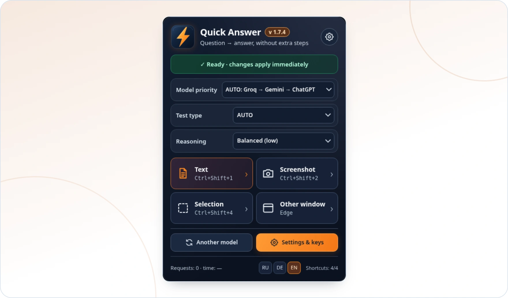

<!-- ppk-readme:head:start -->
<a href="https://popovantondev.github.io/QuickAnswer/index-en.html"><picture><source media="(prefers-color-scheme: dark)" srcset="https://raw.githubusercontent.com/popovantondev/QuickAnswer/main/docs/readme/header-en-dark.8fb497f2.svg"></picture></a>
<!-- ppk-readme:head:end -->

# Quick Answer

[Русский](README.ru.md) · [Deutsch](README.md) · **English**

<!-- ppk-readme:body:start -->

<a href="https://github.com/popovantondev/QuickAnswer"><picture><source media="(prefers-color-scheme: dark)" srcset="https://raw.githubusercontent.com/popovantondev/QuickAnswer/main/docs/readme/btn-source-en-dark.eea9753f.svg"></picture></a>
<a href="https://popovantondev.github.io/QuickAnswer/index-en.html"><picture><source media="(prefers-color-scheme: dark)" srcset="https://raw.githubusercontent.com/popovantondev/QuickAnswer/main/docs/readme/btn-website-en-dark.3c002f76.svg"></picture></a>
<a href="https://popovantondev.github.io/QuickAnswer/Guide-en.html"><picture><source media="(prefers-color-scheme: dark)" srcset="https://raw.githubusercontent.com/popovantondev/QuickAnswer/main/docs/readme/btn-guide-en-dark.16e3ebf2.svg"></picture></a>
<a href="https://github.com/popovantondev/QuickAnswer/issues/new"><picture><source media="(prefers-color-scheme: dark)" srcset="https://raw.githubusercontent.com/popovantondev/QuickAnswer/main/docs/readme/btn-bug-en-dark.fb96a69e.svg"></picture></a>

<a href="https://raw.githubusercontent.com/popovantondev/QuickAnswer/main/docs/assets/screenshots/popup-en.png"><picture><source media="(prefers-color-scheme: dark)" srcset="https://raw.githubusercontent.com/popovantondev/QuickAnswer/main/docs/readme/preview-en-dark.903bd1e6.webp"></picture></a> 
<a href="https://raw.githubusercontent.com/popovantondev/QuickAnswer/main/docs/assets/screenshots/popup-en.png">Full screenshot</a>

<picture><source media="(prefers-color-scheme: dark)" srcset="https://raw.githubusercontent.com/popovantondev/QuickAnswer/main/docs/readme/divider-dark.187dbbf7.svg"></picture>
<!-- ppk-readme:body:end -->

**Quick Answer is a study assistant for self-checking and exam preparation. The rules of your school or university apply: using it in exams, written tests or graded assessments is prohibited.**

**Edge 1.7.8 (in use by the project author) · Desktop 0.1 source preview (Windows runtime not yet verified)**

*Edge screenshot shows demonstration data from an earlier 1.7.x skin; API keys and private pages are not shown.*

The Edge extension reads the text or a screenshot of a page, asks an AI provider with your own key (Groq → Gemini → optional local ChatGPT Bridge) and shows a short answer with a reason you can check. A Windows desktop preview is included as well. The application does not click answers automatically.

| Edge extension | Windows desktop preview |
|---|---|
| Read the visible page text, capture an Edge tab, or select a page region | Capture all monitors, the foreground application window, or a selected screen region |
| Ctrl+Shift+1 / 2 / 3 / 4 | Ctrl+Alt+1 (screen), 2 (window), 4 (region) |
| Per-profile Edge storage and password-encrypted export | DPAPI-encrypted API keys in `%LOCALAPPDATA%\QuickAnswerDesktop` |
| RU / DE / EN, light/dark | RU / DE / EN, compact dark UI |

## First steps

**Edge:** Download or extract the `QuickAnswer-Edge-1.7.8.zip` release archive, open `edge://extensions`, enable Developer mode and **Load unpacked** → `edge-quick-answer`. If updating, copy the new source files over the existing unpacked folder and reload the same extension entry. **Do not remove the extension**: a new extension ID can lose access to the previous browser profile data.

**Desktop:** Extract the `QuickAnswer-Desktop-0.1-SourcePreview.zip` archive and run `START_QuickAnswer.cmd` on Windows 10/11. It uses built-in Windows PowerShell 5.1, WinForms and .NET; no installer or administrator access is required. A school or organisation device can still block script execution or screen capture via policy. Enter Groq / Gemini keys via **API keys**; they are saved for the current Windows user using DPAPI. Desktop uses **different hotkeys** to avoid collisions with Edge. For foreground window capture, focus the target window first and press **Ctrl+Alt+2**.

The **desktop build is an experimental script-based application, not a compiled EXE**, and has not been run on a Windows device in this build environment. Network latency may exceed 15 seconds when providers time out or fail over; no latency guarantee is offered.

## Guides and distribution

[English guide](https://popovantondev.github.io/QuickAnswer/Guide-en.html) · [Deutsche Anleitung](https://popovantondev.github.io/QuickAnswer/Guide-de.html) · [Руководство](https://popovantondev.github.io/QuickAnswer/Guide-ru.html) · [Website](https://popovantondev.github.io/QuickAnswer/index-en.html) · [Rights and privacy](docs/RIGHTS.md)

Locally stored keys never go to the repository. Screenshots and extracted questions **are sent to the selected provider** during inference. Keep API keys and password-encrypted backups out of source control. Desktop screenshots are held in memory and are not saved by default. For ChatGPT, the separate local Codex Bridge must be configured and authenticated; it is not a remote subscription API.

## Limitations

Edge responds only on accessible tabs, may misidentify an answer, and cannot guarantee real-time availability of provider models or free quotas. The desktop source preview has no automatic OCR/DOM read, does not auto-answer or operate other apps, and is not yet Windows-tested. The bundled desktop Bridge is currently incompatible with the browser-only Bridge (Origin validation); use Groq/Gemini for desktop evaluation. Desktop key-dialog labels and some errors are English; RU/DE/EN localization is partial.

## Rights

No license has been selected for the original source code; it is published for viewing. See [RIGHTS.md](docs/RIGHTS.md) ([Deutsch](docs/RIGHTS.de.md) · [Русский](docs/RIGHTS.ru.md)). Names of AI services are used descriptively; this project is not endorsed by their operators.
