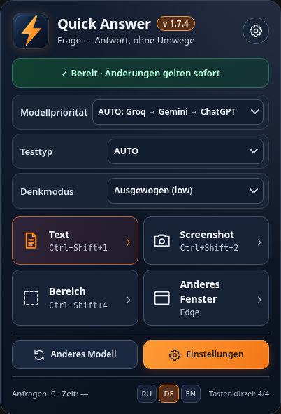

# Quick Answer

**Quick Answer ist ein Lernassistent für Selbstkontrolle und Prüfungsvorbereitung. Es gelten die Regeln Ihrer Schule oder Hochschule: Der Einsatz in Prüfungen, Klausuren und benoteten Tests ist untersagt.**

**Deutsch** · [English](README.en.md) · [Русский](README.ru.md)

[Edge 1.7.8 / Desktop 0.1 Source Preview](https://github.com/popovantondev/QuickAnswer/releases/tag/v1.7.8-desktop-0.1-preview) · [Website](https://popovantondev.github.io/QuickAnswer/index.html) · [Anleitung DE](https://popovantondev.github.io/QuickAnswer/Guide-de.html) · [EN](https://popovantondev.github.io/QuickAnswer/Guide-en.html) · [RU](https://popovantondev.github.io/QuickAnswer/Guide-ru.html)

Die Edge-Erweiterung liest Text oder Screenshot einer Seite, fragt einen KI-Anbieter mit Ihrem eigenen Schlüssel (Groq → Gemini → optional eine lokale ChatGPT-Bridge) und zeigt eine kurze Antwort mit Begründung zum Nachprüfen. Zusätzlich gibt es eine Desktop-Vorschau für Windows. Die Anwendung klickt keine Antworten automatisch an.

**Edge 1.7.8 (beim Projektautor im Einsatz) · Desktop 0.1 Source Preview (unter Windows noch nicht getestet)**

| Edge-Erweiterung | Windows-Desktop-Vorschau |
|---|---|
| Sichtbaren Seitentext lesen, Edge-Tab als Screenshot erfassen oder einen Seitenbereich markieren | Alle Monitore, aktives Anwendungsfenster oder einen Bildschirmbereich erfassen |
| Ctrl+Shift+1 / 2 / 3 / 4 | Ctrl+Alt+1 (Bildschirm), 2 (Fenster), 4 (Bereich) |
| Speicherung im Edge-Profil, Export mit Passwort | Mit DPAPI verschlüsselte Schlüssel in `%LOCALAPPDATA%\QuickAnswerDesktop` |
| RU / DE / EN, hell/dunkel | RU / DE / EN, kompakte dunkle Oberfläche |

*Der Screenshot zeigt Demodaten einer früheren 1.7.x-Oberfläche; Schlüssel und private Seiten sind nicht zu sehen.*

## Erste Schritte

**Edge:** Laden Sie das Archiv `QuickAnswer-Edge-1.7.8.zip` aus den Releases herunter oder entpacken Sie es, öffnen Sie `edge://extensions`, aktivieren Sie den Entwicklermodus und wählen Sie **Entpackte Erweiterung laden** → `edge-quick-answer`. Bei einem Update kopieren Sie die neuen Dateien über den vorhandenen entpackten Ordner und laden dieselbe Erweiterung neu. **Entfernen Sie die Erweiterung nicht**: Eine neue Erweiterungs-ID kann den Zugriff auf die Daten des bisherigen Browserprofils kosten.

**Desktop:** Entpacken Sie `QuickAnswer-Desktop-0.1-SourcePreview.zip` und starten Sie `START_QuickAnswer.cmd` unter Windows 10/11. Es nutzt das vorhandene Windows PowerShell 5.1, WinForms und .NET; weder Installer noch Administratorrechte sind nötig. Eine Organisationsrichtlinie kann Skripte oder Bildschirmaufnahmen trotzdem sperren. Tragen Sie Groq-/Gemini-Schlüssel über **API-Schlüssel** ein; sie werden per DPAPI für den aktuellen Windows-Benutzer gespeichert. Der Desktop-Client nutzt **andere Tastenkürzel** als Edge, um Kollisionen zu vermeiden. Für den Fenster-Screenshot fokussieren Sie zuerst das Zielfenster und drücken **Ctrl+Alt+2**.

Der **Desktop-Client ist eine experimentelle Skriptanwendung, keine kompilierte EXE**, und wurde in dieser Build-Umgebung nicht unter Windows gestartet. Die Netzwerklatenz kann bei Anbieter-Timeouts oder Wechsel des Anbieters 15 Sekunden überschreiten; eine Antwortzeit wird nicht zugesagt.

## Anleitung und Verteilung

[Deutsche Anleitung](https://popovantondev.github.io/QuickAnswer/Guide-de.html) · [English guide](https://popovantondev.github.io/QuickAnswer/Guide-en.html) · [Руководство](https://popovantondev.github.io/QuickAnswer/Guide-ru.html) · [Website](https://popovantondev.github.io/QuickAnswer/index.html) · [Rechte und Datenschutz](docs/RIGHTS.de.md)

Lokal gespeicherte Schlüssel gelangen nie in das Repository. Screenshots und ausgelesene Fragen **werden bei der Anfrage an den gewählten Anbieter gesendet**. Halten Sie API-Schlüssel und passwortgeschützte Sicherungen aus der Versionsverwaltung heraus. Desktop-Screenshots liegen im Arbeitsspeicher und werden standardmäßig nicht gespeichert. Für ChatGPT muss die separate lokale Codex-Bridge eingerichtet und angemeldet sein; sie ist keine entfernte Abo-Schnittstelle.

## Grenzen

Die Edge-Erweiterung antwortet nur auf zugänglichen Tabs, kann Antworten falsch erkennen und kann die Verfügbarkeit von Anbieter-Modellen oder kostenlosen Kontingenten nicht garantieren. Die Desktop-Vorschau liest weder per OCR noch per DOM automatisch, beantwortet nichts selbstständig, bedient keine anderen Anwendungen und ist unter Windows noch nicht getestet. Die mitgelieferte Desktop-Bridge ist derzeit nicht mit der Browser-Bridge kompatibel (Origin-Prüfung); nutzen Sie für die Desktop-Vorschau Groq/Gemini. Der Schlüsseldialog und einzelne Fehlermeldungen der Desktop-Vorschau sind englisch; RU/DE/EN sind dort teilweise lokalisiert.

## Rechte

Für den ursprünglichen Quelltext wurde keine Lizenz gewählt; er ist zur Einsicht veröffentlicht. Einzelheiten stehen in [RIGHTS.de.md](docs/RIGHTS.de.md) ([English](docs/RIGHTS.md) · [Русский](docs/RIGHTS.ru.md)). Namen von KI-Diensten werden beschreibend verwendet; das Projekt wird von deren Betreibern nicht unterstützt.
