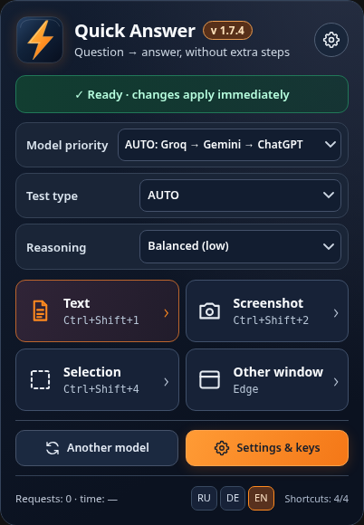

# Quick Answer

[Edge 1.7.8 / Desktop 0.1 Source Preview](https://github.com/popovantondev/QuickAnswer/releases/tag/v1.7.8-desktop-0.1-preview) · [RU](https://popovantondev.github.io/QuickAnswer/Guide-ru.html) · [DE](https://popovantondev.github.io/QuickAnswer/Guide-de.html) · [EN](https://popovantondev.github.io/QuickAnswer/Guide-en.html)

[Русский](docs/README.ru.md) · [Deutsch](docs/README.de.md) · [English](README.md)

A compact educational question assistant for **Microsoft Edge** and **Windows desktop**, with Groq → Gemini → optional local ChatGPT Bridge. Dark navy + orange **Orange Pulse** interface. The application does not click answers automatically.

**Edge 1.7.8 (tested by the project user) · Desktop 0.1 source preview (Windows runtime not yet verified)**

| Edge extension | Windows desktop preview |
|---|---|
| Read the visible quiz, capture an Edge tab, or select a page region | Capture all monitors, foreground application window, or a selected screen region |
| Ctrl+Shift+1 / 2 / 3 / 4 | Ctrl+Alt+1 (screen), 2 (window), 4 (region) |
| Per-profile Edge storage and password-encrypted export | DPAPI-encrypted API keys in `%LOCALAPPDATA%\QuickAnswerDesktop` |
| RU / DE / EN, light/dark | RU / DE / EN, compact navy UI |

*Edge screenshot shows demonstration data from an earlier 1.7.x skin; API keys and private pages are not shown.*

## First steps

**Edge:** Download or extract the `QuickAnswer-Edge-1.7.8.zip` release archive, open `edge://extensions`, enable Developer mode and **Load unpacked** → `edge-quick-answer`. If updating, copy the new source files over the existing unpacked folder and reload the same extension entry. **Do not remove the extension**: a new extension ID can lose access to the previous browser profile data.

**Desktop:** Extract the `QuickAnswer-Desktop-0.1-SourcePreview.zip` archive and run `START_QuickAnswer.cmd` on Windows 10/11. It uses built-in Windows PowerShell 5.1, WinForms and .NET; no installer or administrator access is required. The school device can still block script execution or screen capture via organization policy. Enter Groq / Gemini keys via **API keys**; they are saved for the current Windows user using DPAPI. Desktop uses **different hotkeys** to avoid collisions with Edge. For foreground window capture, focus the target window first and press **Ctrl+Alt+2**.

The **desktop build is an experimental script-based application, not a compiled EXE**, and has not been run on a Windows device in this build environment. Network latency may exceed 15 seconds when providers time out or fail over; no latency guarantee is offered.

## Guides and distribution

[English guide](https://popovantondev.github.io/QuickAnswer/Guide-en.html) · [Deutsches Handbuch](https://popovantondev.github.io/QuickAnswer/Guide-de.html) · [Руководство](https://popovantondev.github.io/QuickAnswer/Guide-ru.html) · [English website](https://popovantondev.github.io/QuickAnswer/index-en.html) · [Design freeze](DESIGN_FREEZE.md) · [Privacy and rights](docs/RIGHTS.md)

Windows Edge never sends your local stored keys to the repository. Screenshots and extracted questions **are sent to the selected provider** during inference. Keep API keys and password-encrypted backups out of source control. Desktop screenshots are held in memory and are not saved by default. For ChatGPT, the separate local Codex Bridge must be configured and authenticated; it is not a remote subscription API.

## Limitations

Edge responds only on accessible tabs, may misidentify an answer, and cannot guarantee real-time availability of provider models or free quotas. Desktop source preview has no automatic OCR/DOM read, does not auto-answer or operate other apps, and is not yet Windows-tested. Some game and school policies prohibit external aids; use only with authorized materials.

No license has been selected for the original project. See [RIGHTS.md](docs/RIGHTS.md) before reuse or redistribution of source. Names of AI services are used descriptively; this project is not endorsed by their operators.

Desktop Bridge is currently incompatible with the bundled browser-only Bridge (Origin validation). Use Groq/Gemini for desktop evaluation. Provider requests, hotkeys, DPI and capture remain untested. Desktop key-dialog labels and some errors are English; RU/DE/EN localization is partial.
