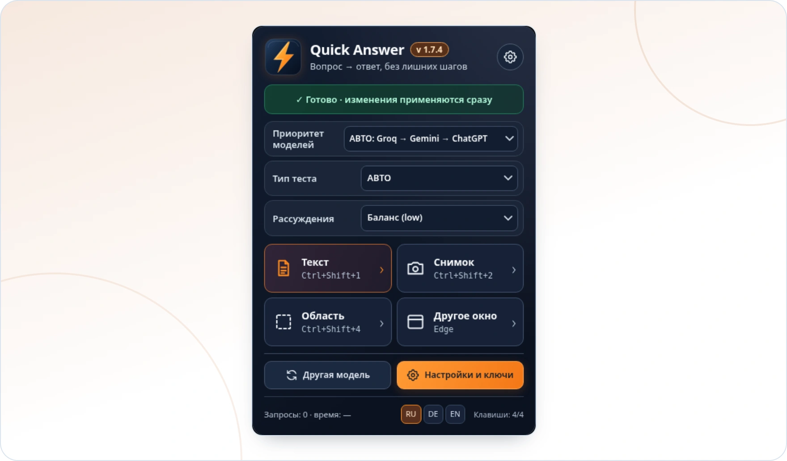

<!-- ppk-readme:head:start -->
<a href="https://popovantondev.github.io/QuickAnswer/index-ru.html"><picture><source media="(prefers-color-scheme: dark)" srcset="https://raw.githubusercontent.com/popovantondev/QuickAnswer/main/docs/readme/header-ru-dark.311a78e3.svg"></picture></a>
<!-- ppk-readme:head:end -->

# Quick Answer

**Русский** · [Deutsch](README.md) · [English](README.en.md)

<!-- ppk-readme:body:start -->

<a href="https://github.com/popovantondev/QuickAnswer"><picture><source media="(prefers-color-scheme: dark)" srcset="https://raw.githubusercontent.com/popovantondev/QuickAnswer/main/docs/readme/btn-source-ru-dark.8ad5ba91.svg"></picture></a>
<a href="https://popovantondev.github.io/QuickAnswer/index-ru.html"><picture><source media="(prefers-color-scheme: dark)" srcset="https://raw.githubusercontent.com/popovantondev/QuickAnswer/main/docs/readme/btn-website-ru-dark.05d60367.svg"></picture></a>
<a href="https://popovantondev.github.io/QuickAnswer/Guide-ru.html"><picture><source media="(prefers-color-scheme: dark)" srcset="https://raw.githubusercontent.com/popovantondev/QuickAnswer/main/docs/readme/btn-guide-ru-dark.4cac85bd.svg"></picture></a>
<a href="https://github.com/popovantondev/QuickAnswer/issues/new"><picture><source media="(prefers-color-scheme: dark)" srcset="https://raw.githubusercontent.com/popovantondev/QuickAnswer/main/docs/readme/btn-bug-ru-dark.f4f157ad.svg"></picture></a>

<a href="https://raw.githubusercontent.com/popovantondev/QuickAnswer/main/docs/assets/screenshots/popup-ru.png"><picture><source media="(prefers-color-scheme: dark)" srcset="https://raw.githubusercontent.com/popovantondev/QuickAnswer/main/docs/readme/preview-ru-dark.e40d0f49.webp"></picture></a> 
<a href="https://raw.githubusercontent.com/popovantondev/QuickAnswer/main/docs/assets/screenshots/popup-ru.png">Снимок целиком</a>

<picture><source media="(prefers-color-scheme: dark)" srcset="https://raw.githubusercontent.com/popovantondev/QuickAnswer/main/docs/readme/divider-dark.187dbbf7.svg"></picture>
<!-- ppk-readme:body:end -->

**Quick Answer — учебный помощник для самопроверки и подготовки. Соблюдайте правила своего учебного заведения: использовать его на экзаменах, контрольных работах и оценочных тестах запрещено.**

**Расширение Edge — 1.7.8 (используется автором проекта). ПК-клиент — 0.1 Preview, ещё не проверен в Windows.**

*На снимке — демонстрационные данные прежнего оформления 1.7.x; ключи и личные страницы не видны.*

Расширение Edge читает текст или снимок страницы, спрашивает ИИ-провайдера по вашему собственному ключу (Groq → Gemini → при подключении локальный ChatGPT Bridge) и показывает короткий ответ с обоснованием, которое можно проверить. Есть и desktop-превью для Windows. Приложение ничего не нажимает автоматически.

| Расширение Edge | Windows-превью для ПК |
|---|---|
| Читать видимый текст страницы, снимать вкладку Edge или выделять область страницы | Снимать все мониторы, активное окно приложения или выбранную область экрана |
| Ctrl+Shift+1 / 2 / 3 / 4 | Ctrl+Alt+1 (экран), 2 (окно), 4 (область) |
| Хранение в профиле Edge, экспорт с паролем | Ключи, зашифрованные DPAPI, в `%LOCALAPPDATA%\QuickAnswerDesktop` |
| RU / DE / EN, светлая/тёмная тема | RU / DE / EN, компактный тёмный интерфейс |

## Первые шаги

**Edge:** Распакуйте ZIP, откройте `edge://extensions`, включите режим разработчика и нажмите **Загрузить распакованное**. Выберите папку `edge-quick-answer`. Для обновления существующей версии копируйте файлы в ту же папку и нажмите **Перезагрузить**, не удаляя расширение. Ключи хранятся в профиле Edge и не входят в ZIP.

Горячие клавиши: `Ctrl+Shift+1` — текст, `Ctrl+Shift+2` — JPEG, `Ctrl+Shift+3` — формат вопроса, `Ctrl+Shift+4` — выделение области.

**Desktop (Windows, без администратора):** Распакуйте папку `desktop`, запустите `START_QuickAnswer.cmd`. Используются встроенные PowerShell 5.1, WinForms, .NET. Установка Python или Node.js не требуется. Политика организации может запретить запуск скриптов. Введите ключи Groq / Gemini в кнопке **Ключи API**.

`Ctrl+Alt+1` — экран, `Ctrl+Alt+2` — активное окно (предварительно переключитесь на него), `Ctrl+Alt+4` — область мышью. Файлы изображений не сохраняются. Ключи для ПК шифруются Windows DPAPI и лежат отдельно от папки программы, в `%LOCALAPPDATA%\QuickAnswerDesktop`.

**Пока это исходный Preview, а не проверенный EXE.** На Windows необходимо проверить запуск, доступ к экрану, хоткеи и настоящие ответы. При недоступности сервиса ожидание может выйти за 15 секунд.

## Руководства и распространение

[Руководство](https://popovantondev.github.io/QuickAnswer/Guide-ru.html) · [Deutsche Anleitung](https://popovantondev.github.io/QuickAnswer/Guide-de.html) · [English guide](https://popovantondev.github.io/QuickAnswer/Guide-en.html) · [Сайт](https://popovantondev.github.io/QuickAnswer/index-ru.html) · [Права и конфиденциальность](docs/RIGHTS.ru.md)

Снимок и текст вопроса отправляются выбранному провайдеру. Не загружайте в публичный репозиторий ключи, токены Bridge, резервные копии, журналы диагностики и личные снимки.

## Ограничения

Desktop пока несовместим с вложенным браузерным Bridge из-за проверки Origin. Для оценки desktop используйте Groq/Gemini. Запросы, захват, DPI и хоткеи не проверены. Окно ключей и часть ошибок на английском; RU/DE/EN локализация частичная. Расширение Edge отвечает только на доступных вкладках и может ошибаться; доступность моделей провайдеров и бесплатных квот не гарантируется.

## Права

Лицензия на собственный код не выбрана; он опубликован для просмотра, подробности — в [RIGHTS.ru.md](docs/RIGHTS.ru.md) ([English](docs/RIGHTS.md) · [Deutsch](docs/RIGHTS.de.md)). Названия ИИ-сервисов используются описательно; их владельцы проект не поддерживают.
